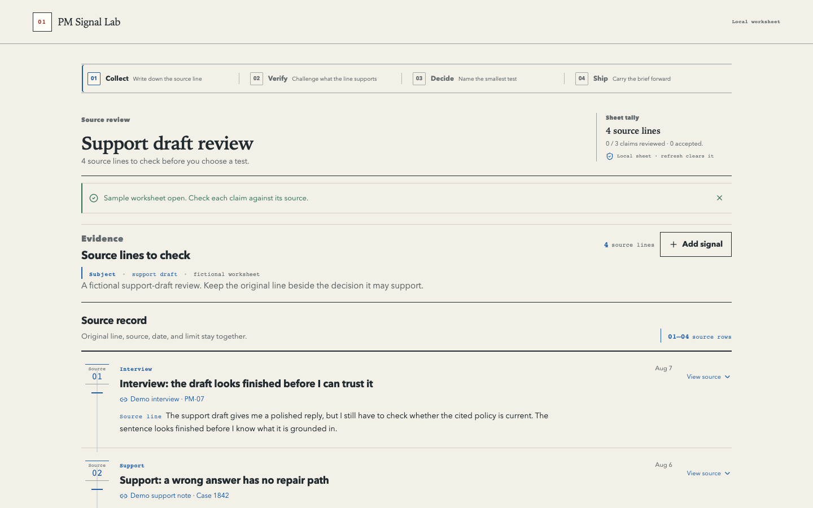
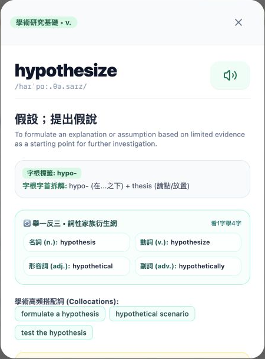
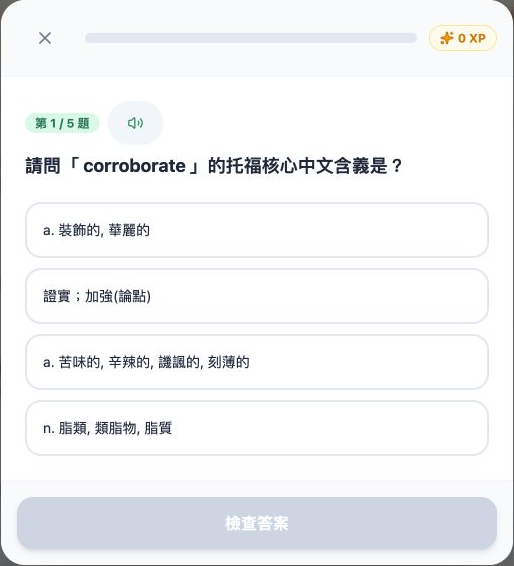

# Tommy — Product portfolio

Technical Product Manager

I build learning tools, native interfaces and the services behind them. My work spans product flows, implementation and handoff.

[中文](README.zh-TW.md) · [All product screens](media/README.md) · [LinkedIn](https://www.linkedin.com/in/chia-en/)

## PM Signal Lab

A worksheet for turning product notes into a decision you can trace back to its source.

*Historical desktop capture · fictional sample notes · August 2026*

I kept the source line beside the claim it supports, so a polished summary cannot quietly become evidence. The repository also includes a fictional AI launch-review exercise with sample responses and a scoring key.

[Code & product walkthrough](https://github.com/asdc163/pm-signal-lab) · [Launch-review exercise](https://github.com/asdc163/pm-signal-lab/tree/main/playbooks/ai-launch-review)

## TOEFL Vocab

A study app that connects word lookup, related word forms and spaced repetition.

 

*Local demo captures · built-in dictionary and quiz · November 2026*

Lookup and review work without a model key. Gemini is an optional extension for learning material; these screens show the no-key flow.

[Code & setup](https://github.com/asdc163/toefl-vocab) · [Model integration notes](docs/ai-capability-evidence.md#toefl-vocab)

## Commercial work

Selected interface and service work, published as anonymized cases. Client source, branding and operating data stay private.

| Product | What I worked on |
| --- | --- |
| [Node service · mobile](cases/node-interface/README.md) | An embeddable React Native module, quote confirmation and the host integration contract. |
| [Spot interface · mobile](cases/spot-interface/README.md) | Order entry, wallet switching and state consistency. Quotes and trades are simulated. |
| [Community quest platform](cases/quest-platform/README.md) | Submission, review and resubmission, with retry-safe points and attachment access. |
| [Telegram community bot](https://github.com/asdc163/telegram-community-bot-case-study) | Private owner controls, permission changes and recovery after uncertain delivery. |
| [VPN subscriptions](https://github.com/asdc163/vpn-subscription-case-study) | Checkout, renewal and reconciling payment with client access. |

Each case links to selected screens and records its delivery status. Simulator checks, local fixtures and historical captures are identified in context.

## Other projects

[CareLens](https://github.com/asdc163/carelens) explores family-care coordination with image input and no-key mocks. It is a prototype, with no clinical or model-accuracy claim. [OpenClaw Dashboard](https://github.com/altoslab447/openclaw-dashboard) is a read-only workspace view. [ethers-v6-codemod](https://github.com/asdc163/ethers-v6-codemod) covers selected AST-based migration patterns.

[Product decisions](docs/tpm-review-guide.md) · [Technical notes](notes/structured-output.md) · [Website assets](media/WEBSITE-HANDOFF.md)
