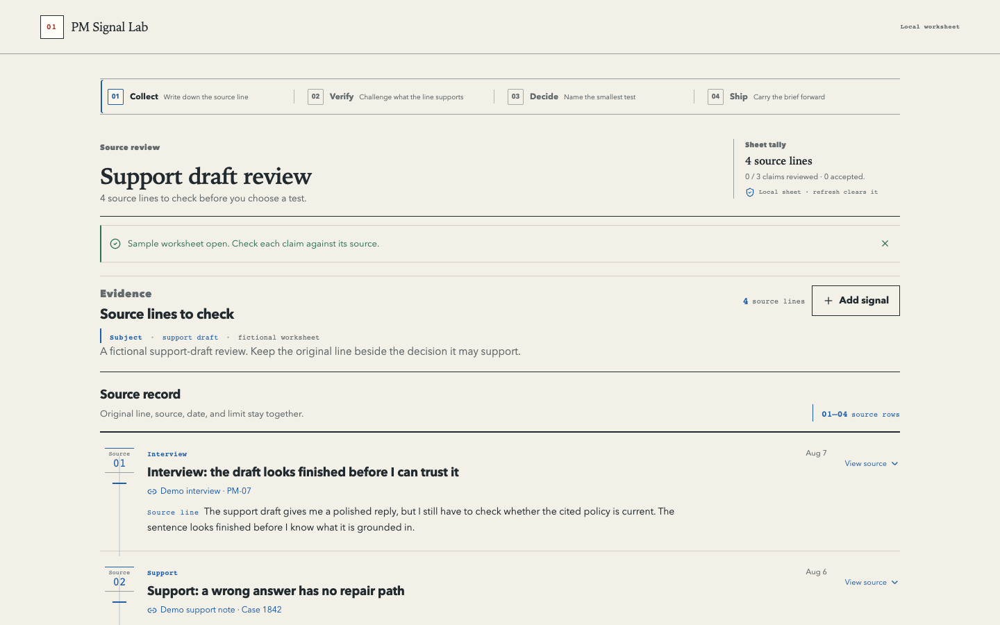
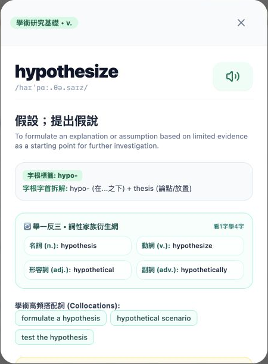
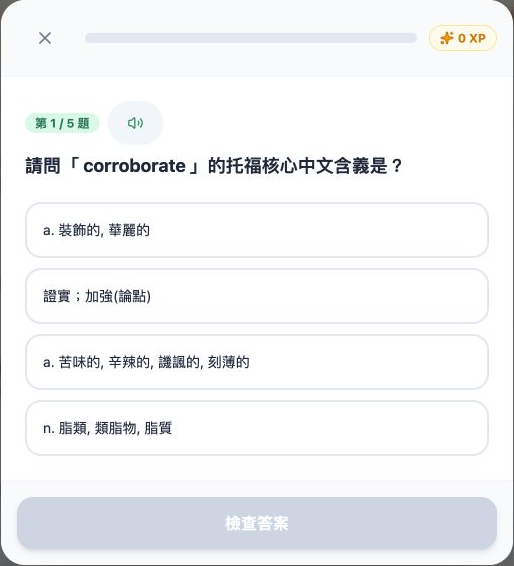

# Tommy 的產品作品集

Technical Product Manager

我做學習工具、手機介面，以及支撐產品流程的服務。從規劃、實作到交接，這裡保留能公開展示的作品與取捨。

[English](README.md) · [完整產品畫面](media/README.zh-TW.md) · [LinkedIn](https://www.linkedin.com/in/chia-en/)

## PM Signal Lab

把產品筆記整理成能回查來源的決策工作表。

*歷史桌面畫面 · 虛構示範筆記 · 2026 年 8 月*

我把原始語句留在主張旁邊，讓審查者能看出結論從哪裡來。程式庫也附有 AI 上線審查練習，包含自編回覆與評分規則。

[程式與產品說明](https://github.com/asdc163/pm-signal-lab) · [上線審查練習](https://github.com/asdc163/pm-signal-lab/tree/main/playbooks/ai-launch-review)

## TOEFL Vocab

從查字、詞性衍生到間隔複習，串成一段完整的學習流程。

 

*本機示範截圖 · 內建字典與測驗 · 2026 年 11 月*

查字與複習不需要模型金鑰。Gemini 用來擴充學習素材，這裡展示的是無金鑰流程。

[程式與啟動方式](https://github.com/asdc163/toefl-vocab) · [模型整合筆記](docs/ai-capability-evidence.zh-TW.md#toefl-vocab)

## 商用產品

以下用匿名案例呈現介面與服務工作；客戶程式、原品牌及營運資料維持私有。

| 產品 | 我的工作 |
| --- | --- |
| [節點服務手機介面](cases/node-interface/README.zh-TW.md) | 可嵌入的 React Native 模組、報價確認與宿主整合契約。 |
| [現貨交易介面](cases/spot-interface/README.zh-TW.md) | 委託操作、錢包切換與狀態一致性；報價與交易均為模擬。 |
| [社群任務平台](cases/quest-platform/README.zh-TW.md) | 送件、審核與補件流程，處理重試發點及附件權限。 |
| [Telegram 社群機器人](https://github.com/asdc163/telegram-community-bot-case-study) | 群主私訊管理、權限變動與投遞結果不明時的恢復。 |
| [VPN 訂閱系統](https://github.com/asdc163/vpn-subscription-case-study) | 結帳、續費，以及付款狀態與客戶端權限的對帳。 |

各案例附有篩選後的畫面與交付狀態，並在原處標明模擬器、本機資料與歷史截圖的範圍。

## 其他作品

[CareLens](https://github.com/asdc163/carelens) 是家庭照護協作原型，探索圖片輸入與無金鑰 mock，尚未建立醫療或模型準確率證據。[OpenClaw Dashboard](https://github.com/altoslab447/openclaw-dashboard) 提供唯讀工作區視圖；[ethers-v6-codemod](https://github.com/asdc163/ethers-v6-codemod) 處理特定 AST 程式遷移模式。

[產品取捨](docs/tpm-review-guide.zh-TW.md) · [技術筆記](notes/structured-output.zh-TW.md) · [網站素材](media/WEBSITE-HANDOFF.md)
