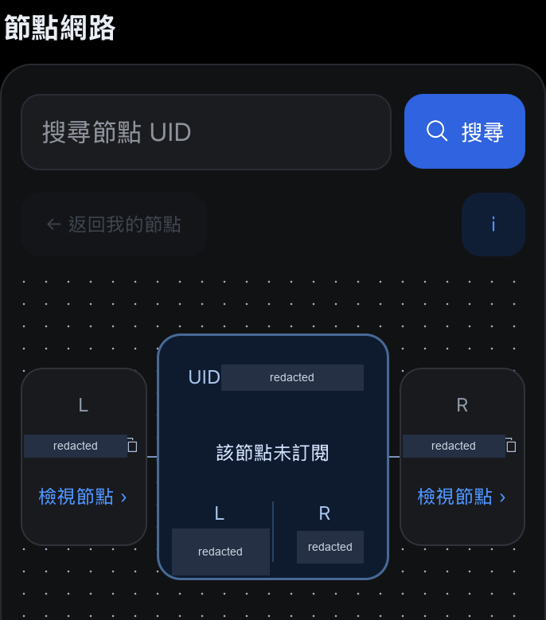

# Node service mobile interface

A React Native frontend for node-service orders, account information and network views. I worked on the screen flows, host integration contract, confirmation and recovery states, and the separate iOS and Android review builds.

The delivery includes an embeddable TypeScript module and an isolated React Native CLI app for acceptance checks. The source, original artwork and release packages remain private.

[繁體中文](README.zh-TW.md) · [Projects](../../README.md)

## Interface excerpt

Historical iOS Simulator network component. Identifiers and numeric values are removed.

[More screens and capture notes](../../media/README.md#node-service-mobile-interface)

## Give the host a clear responsibility

The receiving app supplies the service and native capabilities. Account state, quotes and submission results come through that contract. The acceptance app uses local fixtures; those fixtures are kept outside the module's dependency graph.

| Module | Receiving app |
| --- | --- |
| Displays account state, checks quote shape and manages confirmation, pending and recovery states. | Supplies authoritative data, authorization and submission results; enforces service-side rules. |
| Calls navigation, clipboard and backdrop interfaces. Can hide its own bottom navigation. | Connects actual routes and native capabilities, and reserves space for its own navigation. |

That boundary lets the receiver integrate the interface without importing the acceptance app or adopting its test data.

## An old confirmation should not survive a changed quote

Before submission, the interface checks the quote deadline and account revision. If either has changed, it clears the prior authorization and asks the user to review a refreshed quote. Ordinary operations share a lock so a keyboard submission and a button press use the same busy guard.

A submission error is a different problem. The interface stops automatic resubmission and asks the user to refresh the account and inspect its records. The prepared operation retains its identity until the intent is cancelled or replaced. The host still has to reconcile pending results and enforce idempotency; a missing record in one snapshot does not prove a real transaction failed.

## A copy button has to remain tappable

During visual polish, a copy target extended outside its card. I redistributed the header space rather than shrinking the target. Later feedback placement also had to preserve the form: the message moved into the existing header row so confirmation controls stayed in place.

The layout accounts for the host's navigation and safe area. Feedback avoids the bottom controls and does not intercept taps. Review records distinguish visual alignment from the actual native touch frame, including larger text and landscape checks.

## Delivery scope

The records include unit and type checks, dependency-boundary checks, selected iOS Simulator and Android Emulator journeys, and separate consumer type/bundle checks. The consumer's native UI was not exercised. Platform checks were recorded across named revisions rather than described as one complete final-version run.

This portfolio write-up reviewed those records and the relevant implementation; it did not rerun the app. Physical devices, signed iOS distribution and integration with real backend, wallet and chain services remain receiver-side acceptance work.

This anonymized case omits client identity, private source and releases, reference assets, account identifiers, balances and operating data.
