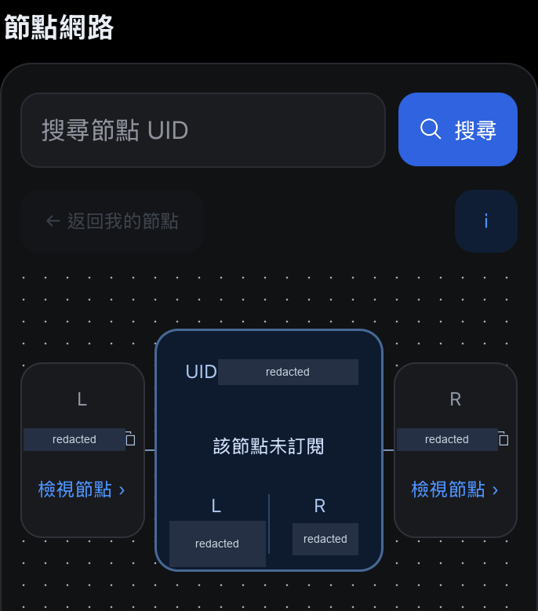

# 節點服務手機介面

以 React Native 實作節點服務的訂單、帳戶資訊與網路畫面。我負責畫面流程、宿主整合契約、確認與恢復狀態，以及分開記錄的 iOS、Android 審查版本。

交付包含可嵌入的 TypeScript 模組，以及供隔離驗收的 React Native CLI App。原始碼、原始素材與版本交付包維持私有。

[English](README.md) · [作品集](../../README.zh-TW.md)

## 介面片段

歷史 iOS Simulator 節點網路元件；已移除識別碼與數值。

[更多畫面與拍攝說明](../../media/README.zh-TW.md#節點服務手機介面)

## 把宿主需要負責的事講清楚

接手的 App 提供服務與原生能力，透過契約傳入帳戶狀態、報價和提交結果。驗收 App 使用本機測試資料；這些資料和測試服務留在模組依賴圖之外。

| 介面模組 | 接手的 App |
| --- | --- |
| 呈現帳戶狀態、檢查報價格式，管理確認、待處理與恢復狀態。 | 提供權威資料、授權與提交結果，執行服務端規則。 |
| 呼叫導覽、剪貼簿與背景層介面，可隱藏自己的底部導覽。 | 接上實際路由與原生能力，為既有導覽保留內容空間。 |

這樣接手方可以整合畫面，不必一起帶入驗收 App 或它的測試資料。

## 報價改變，舊確認就要失效

提交前，介面檢查報價期限與帳戶版本。只要其中一項改變，就清除先前授權，取得新報價並請使用者重新核對。一般操作共用忙碌鎖，鍵盤送出和點擊按鈕走相同的防重複入口。

提交出錯則需要另一條路徑：介面停止自動重送，提示先重新整理帳戶並查看紀錄。準備中的操作會保留識別，直到取消或建立新的意圖。宿主仍須核對待處理結果並避免重複執行；單次快照沒有紀錄，不能用來判定真實交易已失敗。

## 複製按鈕看起來對齊，還要真的點得到

視覺修整時，曾發現複製按鈕的觸控區超出卡片。我重新分配標頭空間，保留按鈕的可點範圍。提示位置也不能推動表單，後來改放在既有標頭列內，讓確認操作維持原位。

版面會考慮宿主的導覽與安全區，提示避開底部控制，也不攔截點擊。審查紀錄分開核對視覺對齊與原生觸控框，並包含放大字級及橫向畫面的檢查。

## 交付範圍

紀錄包含單元與型別檢查、模組依賴界線、選定的 iOS Simulator 與 Android Emulator 旅程，以及獨立接入專案的型別和打包檢查。該接入專案沒有執行原生 UI；兩端的操作也依版本記錄，沒有合併稱為最終版本一次完整重跑。

本次作品集對照了這些紀錄與相關實作，沒有重新執行 App。實體裝置、iOS 正式簽章，以及真實後端、錢包和鏈上服務，仍需在接手環境驗收。

開發過程使用 AI 協作。公開案例已省略客戶身分、私人程式與版本、參考素材、帳戶識別、餘額及營運數據。
