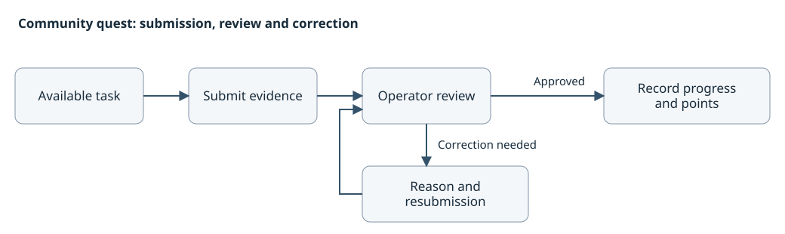

# Community quest platform

A platform for community campaigns, with participant tasks and an operator workspace. I worked on the product flows, web interface, API and data model, background verification, and the setup and acceptance guide.

The implementation uses TypeScript, Next.js, a NestJS/Fastify API, PostgreSQL and queued workers. The source and handoff package remain private.

[繁體中文](README.zh-TW.md) · [Projects](../../README.md)

## A rejected submission needs a way back

Participants can submit evidence, read a review reason and send a correction. Operators need the task, evidence and prior decision together when they review it again. I kept these as explicit transitions rather than treating every unsuccessful check as the same error.

An unmet condition, a provider failure and a submission waiting for human review have different next actions. The interface follows the backend state so a retry does not imply that the participant has completed the task.

Conceptual flow, rewritten for this case. It contains no client records or production identifiers.

## A lost response must not award points twice

An operator may make a points adjustment, lose the response and try again. The implementation associates the adjustment with a stable request identity, checks the project permission and records the ledger change and audit entry in a transaction. Retrying the same request returns the existing result; changing its meaning is a conflict.

That adds recovery behavior to the admin flow. A spinner or a second click alone cannot tell the operator whether the first adjustment took effect.

Evidence files have a separate boundary. Reading an attachment requires access to that submission, and a file already referenced by a submission cannot be removed as if it were an unused upload.

## Handoff was part of the build

The final delivery records cover extracting the package into a fresh location, building and starting it, exercising participant and operator flows, and checking persistence after a restart. I reviewed the final package receipt alongside the implementation and delivery notes for this write-up.

This is a private implementation with a local handoff verification record. It is not presented as a public live service. Recipient-host acceptance, real wallet-provider use and configured external services need their own verification. The portfolio update did not rerun the application.

Development was AI-assisted. Task verification, permissions and points use explicit application rules. Client identity, source, deployments, accounts, evidence files and operating data are omitted.
