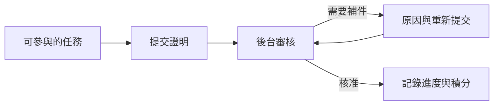

# 社群任務平台

讓參與者完成活動任務、提交證明，也讓營運人員在後台審核與處理例外。我負責產品流程、網頁介面、API 與資料模型、背景驗證，以及接手方的啟動和驗收說明。

實作使用 TypeScript、Next.js、NestJS/Fastify API、PostgreSQL 與背景佇列。原始碼和交付包維持私有。

[English](README.md) · [作品集](../../README.zh-TW.md)

## 被退回之後，參與者要知道怎麼補

參與者可以提交證明、讀取退回原因，再補件送審。營運人員重新審核時，也需要一起看到任務、證明和先前的決定。我把這些做成明確的狀態轉換，沒有把所有未完成結果都塞成同一種錯誤。

條件未達成、外部服務失敗、等待人工審核，各自需要不同的下一步。介面依後端狀態呈現；按下重試，不代表任務已經完成。

這是為作品集重寫的概念流程，不含客戶紀錄或正式環境識別資訊。

## 回應遺失，不應該多加一次積分

營運人員調整積分後，可能沒收到回應而重試。實作以固定請求識別核對這次調整，確認專案權限，並在同一筆資料庫交易內寫入帳本與稽核。相同請求重送時回傳既有結果；同一識別碼若改了內容，則回報衝突。

後台因此需要恢復路徑。只顯示轉圈，或讓人再按一次，無法回答第一次調整到底有沒有生效。

附件也有自己的權限界線：讀取檔案要有該提交的存取權；已被提交引用的證明，不能再當成未使用的上傳檔刪除。

## 接手方能不能啟動，也是交付的一部分

最終交付紀錄包含在新目錄解壓、建置與啟動，操作參與者和後台流程，以及重啟後確認資料保留。這篇案例對照了最終交付回執、實作與交接文件。

目前公開的是私有實作的案例，以及本機交接驗證範圍。沒有提供公開服務入口；接收方主機、真實錢包供應商與外部服務，仍需各自驗收。本次整理作品集沒有重新執行產品。

開發過程使用 AI 協作；任務驗證、權限與積分由明確的程式規則處理。客戶身分、原始碼、部署、帳號、證明附件及營運數據均未公開。
