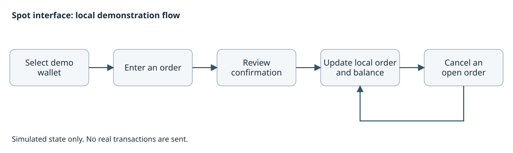

# Spot trading interface

A React Native implementation of a supplied trading-interface reference, built for product review and frontend handoff. I worked on the screen behavior, local order model, wallet and network switching, and separate iOS and Android checks.

The app uses TypeScript and Expo. It is a frontend demonstration with simulated quotes, orders and balances. It does not hold funds or send real transactions.

[繁體中文](README.zh-TW.md) · [Projects](../../README.md)

## The review needs a complete action

The scope includes entering a limit or market order, checking the confirmation, seeing the resulting local order or balance, and cancelling an open order. Wallet selection and a simple return path are included so the reviewer can get to the trading screen without an unfinished onboarding step.

Watch-only wallets block trading actions. The user must change to an eligible demonstration wallet to continue. Confirmation and cancellation are part of the behavior being reviewed, alongside the layout.

This is a conceptual demonstration flow. It contains no real account, price, balance or signing data.

## Wallet switching exposed a state race

A reducer-level reproduction showed a timing problem: a quote update could fill an order, then an older session snapshot could put that order back into the open state when the wallet changed.

I changed normal session transitions to compute from the reducer's current state. Whole-session replacement was kept for explicit loading and recovery. Regression cases check both event orders around wallet transitions. The reproduction was in the state model; it was not claimed as a reproduced native-screen failure.

That distinction matters for the handoff. A visual match would not have caught this data-consistency problem.

## iOS and Android were checked separately

The delivery records include selected iOS Simulator journeys and Android Emulator runs, with narrow layouts, larger text, landscape dialogs and keyboard states. The Android review package includes its JavaScript bundle so the reviewer does not need a development server.

The records cover different named versions and selected runs, not a single full pass on both platforms. I reviewed those boundaries and the state fix for this case; this portfolio update did not rerun the app. Physical devices, a store release, complete assistive-technology coverage and real trading services remain outside the demonstrated scope.

Development was AI-assisted. The simulated trading behavior is deterministic. Commercial source, original branding, reference assets, private releases, recipient details and account data are omitted from the public case.
