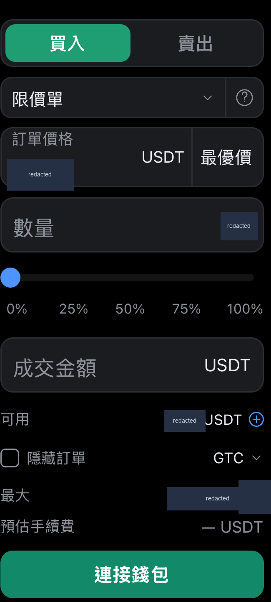
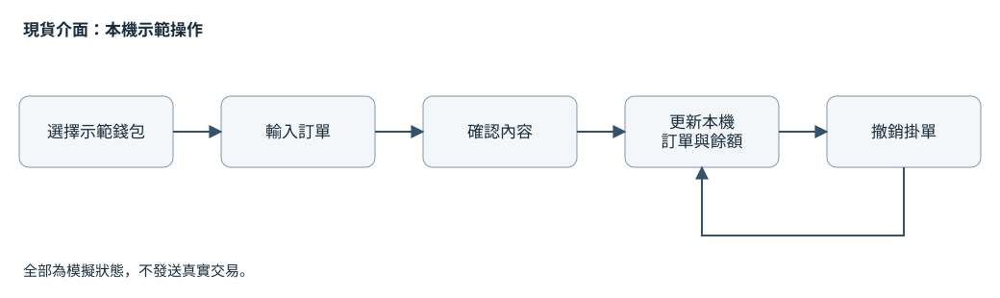

# 現貨交易介面

依指定的交易介面參考，以 React Native 實作供產品審查與前端接手的版本。我負責畫面行為、本機訂單模型、錢包與網路切換，以及分開進行的 iOS、Android 檢查。

目前交付使用 TypeScript 與 React Native Community CLI，早期 Expo 審查版保留為歷史紀錄。報價、訂單和餘額都是前端示範狀態，不保管資產，也不發送真實交易。

[English](README.md) · [作品集](../../README.zh-TW.md)

## 介面片段

原生 iOS 純前端示範；裁取下單表單，移除財務數值與客製資產名稱。

[更多畫面與拍攝說明](../../media/README.zh-TW.md#現貨交易介面)

## 審查時，要能走完一次操作

範圍包含限價或市價輸入、確認內容、查看本機訂單與餘額，以及撤銷掛單。錢包選擇和簡單的返回路徑也一起完成，讓驗收者能順利進入現貨頁，不會先卡在未完成的引導。

觀察錢包會阻擋交易操作，必須切換到可操作的示範錢包才能繼續。確認與取消都屬於這次要驗收的行為，和版面一起檢查。

這是概念性的示範流程，不含真實帳號、價格、餘額或簽名資料。

## 切換錢包，暴露了狀態更新的時序問題

在 reducer 層重現過一個問題：行情更新先讓訂單成交，接著切換錢包時送回較舊的 session 快照，就可能把那張訂單恢復成掛單。

我把一般 session 轉換改成依 reducer 當下狀態計算；整份快照替換只留給明確的初始讀取與恢復。回歸案例檢查錢包轉換前後兩種事件順序。這次重現發生在狀態模型，沒有把它寫成已在原生畫面重現的故障。

這也是前端接手時需要交代的事。只核對畫面外觀，抓不到這種資料一致性問題。

## 接手團隊需要原生交付

第一個審查包使用 Expo。收到工程回饋後，我把交付改為 Community CLI，納入 iOS、Android 原生工程，並將畫面、互動元件、控制器、訂單模型、儲存與平台介面的職責拆開。

接手團隊應提供正式的身分、行情、交易及簽名服務。本機示範控制器不能直接當成正式交易服務。

## iOS、Android 的證據分開看

最新原生交付紀錄包含最終來源的選定 iOS Simulator 旅程。Android 的較廣原生基線與工具列文字修正後的最終響應檢查分開記錄。審查版本不需要開發伺服器；紀錄包含窄版、大字級、橫向彈窗及原生匯出或分享狀態。

這些紀錄對應不同的具名版本與選定測試，沒有當成同一輪雙端全套通過。本次案例檢查了這些界線與狀態修正，沒有重新執行 App。實體裝置、商店發布、完整輔助科技覆蓋和真實交易服務，均不在這次展示範圍。

開發過程使用 AI 協作；示範交易依確定的程式規則運作。商用原始碼、原品牌、參考素材、私人版本、接收方資訊及帳戶資料均未公開。
