# Product screens and cases

[繁體中文](README.zh-TW.md) · [Projects](../README.md) · [Website data](../portfolio.json)

These are actual product or prototype captures. Commercial excerpts use crops and opaque redactions; no interface was reconstructed. Captions distinguish dates, platforms and evidence limits.

Historical captures and local demonstrations do not establish current production operation, real settlement or model performance. Project start and end dates were not supplied and are not inferred from image dates.

[Website integration notes](WEBSITE-HANDOFF.md)

## Node service mobile interface

A native module that a receiving app can embed without adopting the acceptance host.

**My work:** Product flow, AI-assisted implementation, integration boundaries and platform acceptance review.

**Decision:** A confirmation checks its quote snapshot again; services and navigation remain host responsibilities.

**AI scope:** AI-assisted engineering; the demonstrated product behavior is deterministic.

No physical-device, live wallet, production service or store-release claim.

[Case / source](https://github.com/asdc163/ai-builder-portfolio/tree/main/cases/node-interface)

### Node search and network cards

iOS Simulator · 2026-10-31 · 686 × 779

Historical iOS component capture. Node identifiers and numeric values are removed.

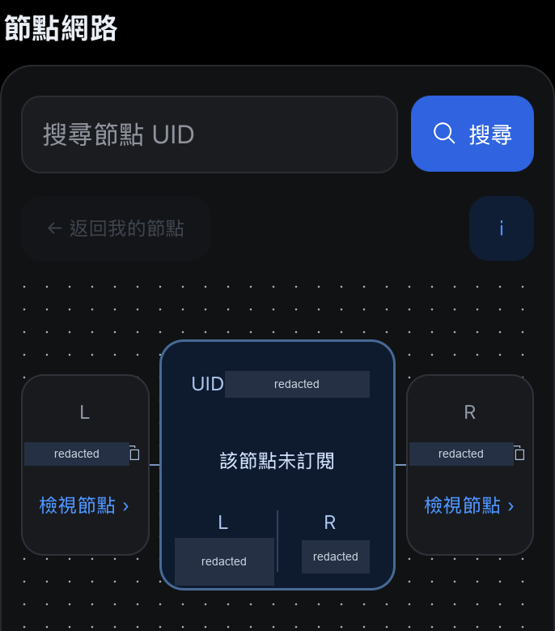

[Open full size](node-interface/ios-network.png)

### Android network layout

Android Emulator · 2026-10-30 · 1029 × 1240

A separate Android capture of the same component. Identifiers and numeric values are removed.

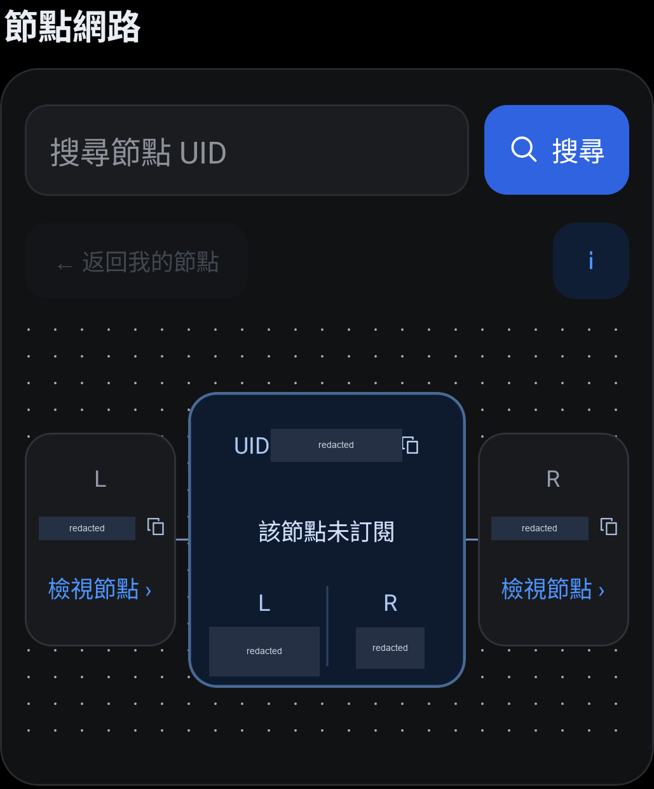

[Open full size](node-interface/android-network.png)

## Community quest platform

Participant submissions and operator review, including retries and corrections.

**My work:** Participant and operator flows, implementation, recovery rules and handoff review.

**Decision:** A retry must not award points twice, and an attachment needs an explicit access boundary.

**AI scope:** AI-assisted delivery. Local task and review records do not establish live model or provider behavior.

No public hosting, recipient deployment, real-wallet or live-provider claim.

[Case / source](https://github.com/asdc163/ai-builder-portfolio/tree/main/cases/quest-platform)

### Submission waiting for review

Chrome mobile viewport · 2026-10-30 · 358 × 246

Actual task dialog from a local frontend review. Cropped to exclude branding, account context and background data.

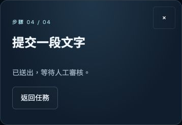

[Open full size](quest-platform/submission-waiting.png)

### Rejection reason and correction entry

Chrome mobile viewport · 2026-10-30 · 358 × 408

The same task after review requests a correction. Background and review timestamp are removed.

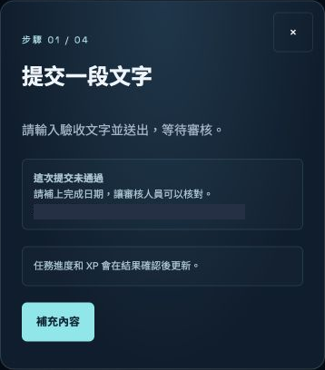

[Open full size](quest-platform/submission-needs-changes.png)

## Spot trading interface

A standalone native frontend demonstration with local order state.

**My work:** Screen behavior, state consistency, native handoff and separate platform review.

**Decision:** Session transitions use current reducer state; native platform adapters are separate from the demo controller.

**AI scope:** AI-assisted development; quotes, orders and signing are local simulations.

No real funds or trades. Platform checks cover named versions and selected runs, not one final full sweep.

[Case / source](https://github.com/asdc163/ai-builder-portfolio/tree/main/cases/spot-interface)

### Simulated order entry

iOS Simulator · 2026-10-30 · 650 × 1440

Native frontend demonstration. Cropped below the branded header; quote values, balances and custom asset labels are removed.

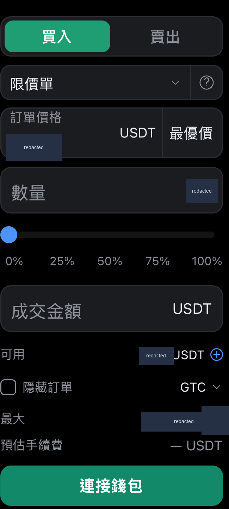

[Open full size](spot-interface/ios-order-entry.png)

### Local order confirmation result

iOS Simulator · 2026-10-30 · 1178 × 815

A simulated local order, not a real trade. Order values, times, balances and custom asset labels are removed.

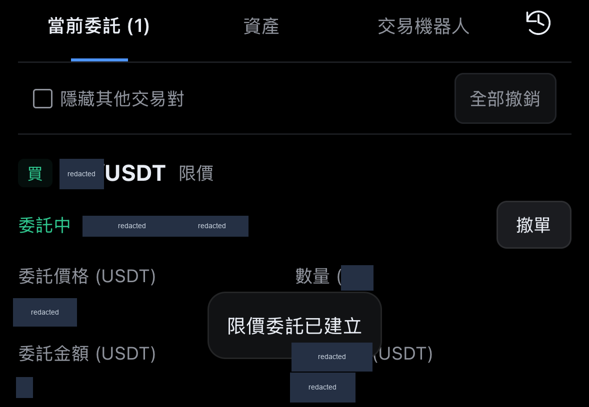

[Open full size](spot-interface/ios-order-result.png)

### Narrow layout with larger text

Android Emulator · 2026-10-30 · 1080 × 2185

Historical final responsive-check capture. Financial values are removed; slider percentages are fixed controls.

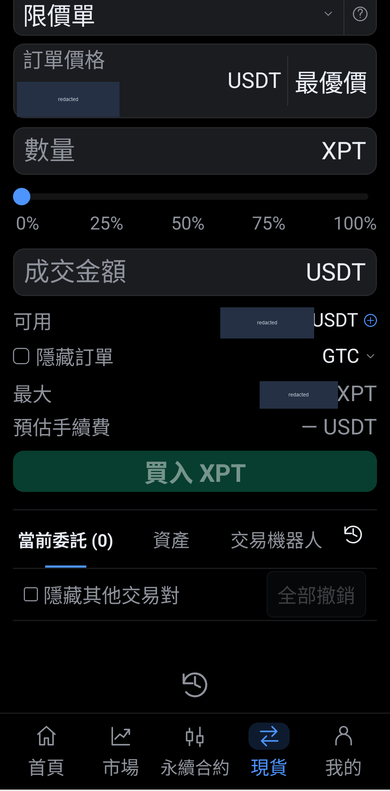

[Open full size](spot-interface/android-large-text.png)

## TOEFL Vocab

Offline vocabulary study with optional Gemini extensions.

**My work:** Learning flow, dictionary organization, optional model paths and AI-assisted implementation.

**Decision:** The core dictionary and review task should remain usable without a model key.

**AI scope:** Gemini integration exists in public source. These screenshots exercise only the no-key path.

No provider-quality, learning-outcome or hosted-availability claim from this capture.

[Case / source](https://github.com/asdc163/toefl-vocab)

### Dictionary meaning and word family

Chrome desktop · 2026-11-01 · 450 × 610

Fresh local capture from public source, using the no-key dictionary path. Cropped to the upper portion of the dialog. Gemini was not exercised.

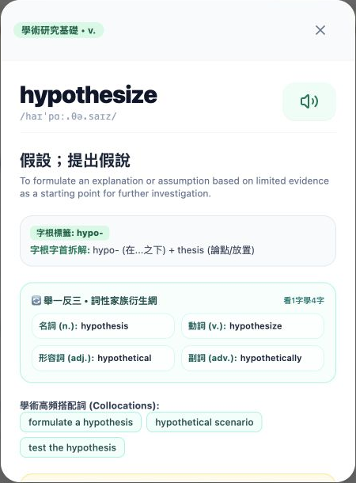

[Open full size](toefl-vocab/word-detail.png)

### Vocabulary practice question

Chrome desktop · 2026-11-01 · 514 × 566

Fresh local capture with default demonstration progress. No learner records or provider result are shown.

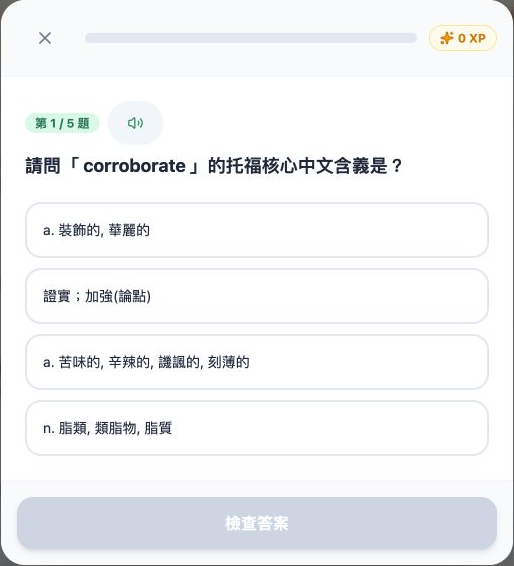

[Open full size](toefl-vocab/quiz-question.png)

## PM Signal Lab

A local-first worksheet and authored exercises for product decisions.

**My work:** Source-to-decision workflow, evidence boundaries and an authored AI launch-review exercise.

**Decision:** A polished response is not enough; unsupported decisions need an explicit review gate.

**AI scope:** AI product evaluation material. The published exercise is fictional, not a live-model benchmark.

Screenshots do not establish a fresh hosted release, participant study or growth result.

[Case / source](https://github.com/asdc163/pm-signal-lab)

### First-run worksheet on desktop

Chrome desktop · 2026-08-16 · 1440 × 1000

Historical local capture with a labelled fictional interview. UI pixels are unchanged.

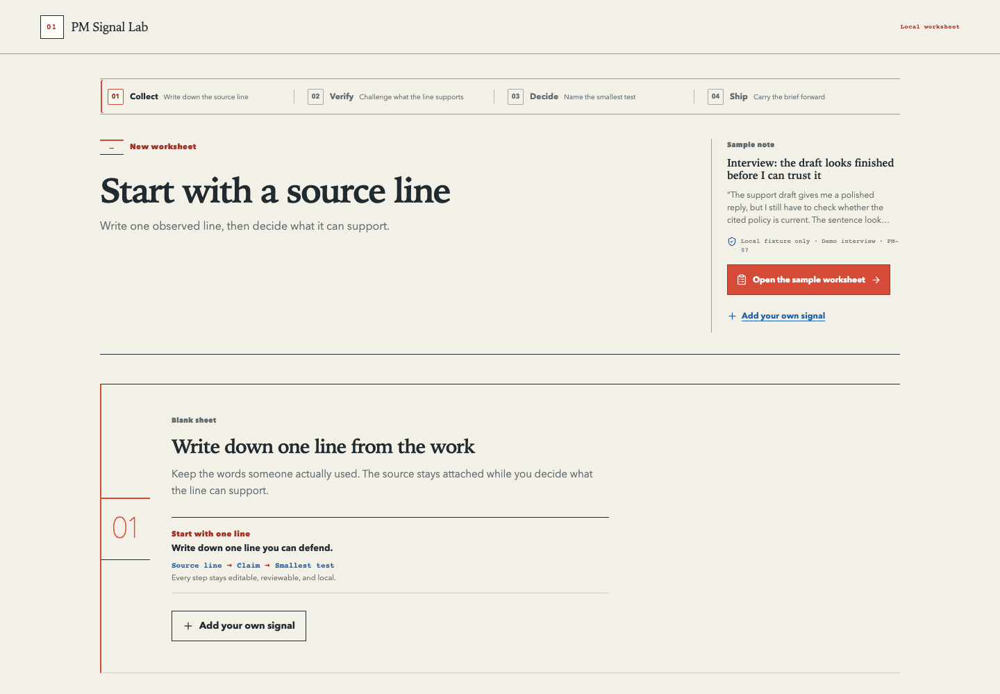

[Open full size](pm-signal-lab/first-run-desktop.png)

### First-run worksheet on a narrow screen

Chrome mobile viewport · 2026-08-16 · 390 × 844

Historical responsive capture of the same first-run state. UI pixels are unchanged.

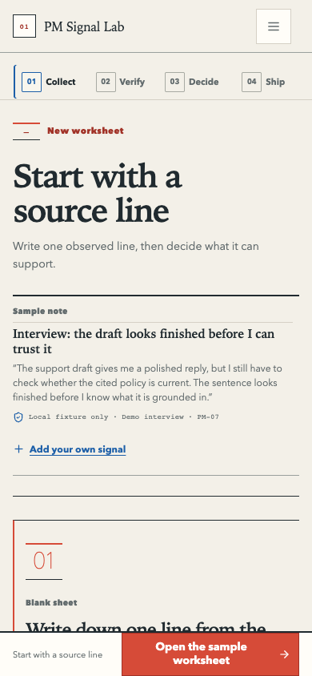

[Open full size](pm-signal-lab/first-run-mobile.png)

## OpenClaw Dashboard

A local dashboard for inspecting an agent workspace without running actions.

**My work:** Read-only operations view, parser boundaries and public handoff documentation.

**Decision:** Observation should not also grant a route to execute agent actions.

**AI scope:** Agent-operations tooling. The capture uses a fictional empty workspace, not a live agent run.

No hosted control-plane, authentication or live-agent-performance claim.

[Case / source](https://github.com/altoslab447/openclaw-dashboard)

### Read-only dashboard with an empty sample workspace

Chrome desktop · 2026-11-01 · 1470 × 717

Fresh local capture using an isolated, explicitly fictional workspace. No live agent, private configuration or operational log is shown. UI pixels are unchanged.

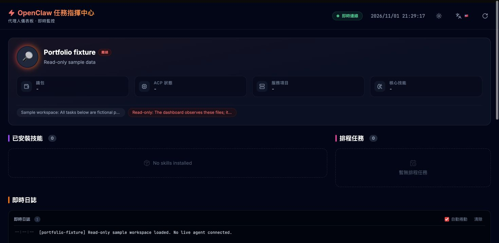

[Open full size](openclaw-dashboard/synthetic-workspace.png)

## Telegram community bot

Community participation, private owner controls and uncertain-delivery recovery.

**My work:** Participation rules, role checks, delivery behavior and commercial handoff review.

**Decision:** Recheck ownership for sensitive actions and preserve unknown delivery outcomes.

**AI scope:** AI-assisted engineering. Bot rules and delivery decisions are deterministic.

The historical image predates owner-only private management and must not be used as current-flow evidence.

[Case / source](https://github.com/asdc163/telegram-community-bot-case-study)

### Earlier operations menu

Telegram client · 2026-10-13 · 464 × 280

Historical excerpt captured before management moved to owner-only private chat. It illustrates feature coverage, not the current permission flow. Branding and chat context are cropped out.

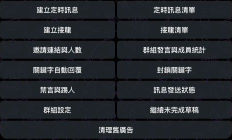

[Open full size](telegram-community-bot/historical-command-inventory.png)

## VPN subscription system

Subscription checkout, payment reconciliation and client-access states.

**My work:** Renewal flow, payment-state boundaries, client recovery and engineering handoff review.

**Decision:** Returning from payment is not settlement; a pending order needs a clear recovery path.

**AI scope:** AI-assisted development; payment and access decisions follow deterministic rules.

No real-funds, physical-device, target-network or consumer-release claim.

[Case / source](https://github.com/asdc163/vpn-subscription-case-study)

### Renewal plan selection

iOS Simulator · 2026-10-15 · 1110 × 1010

Historical engineering-review UI. Prices and payment-route details are removed; this image does not establish network availability.

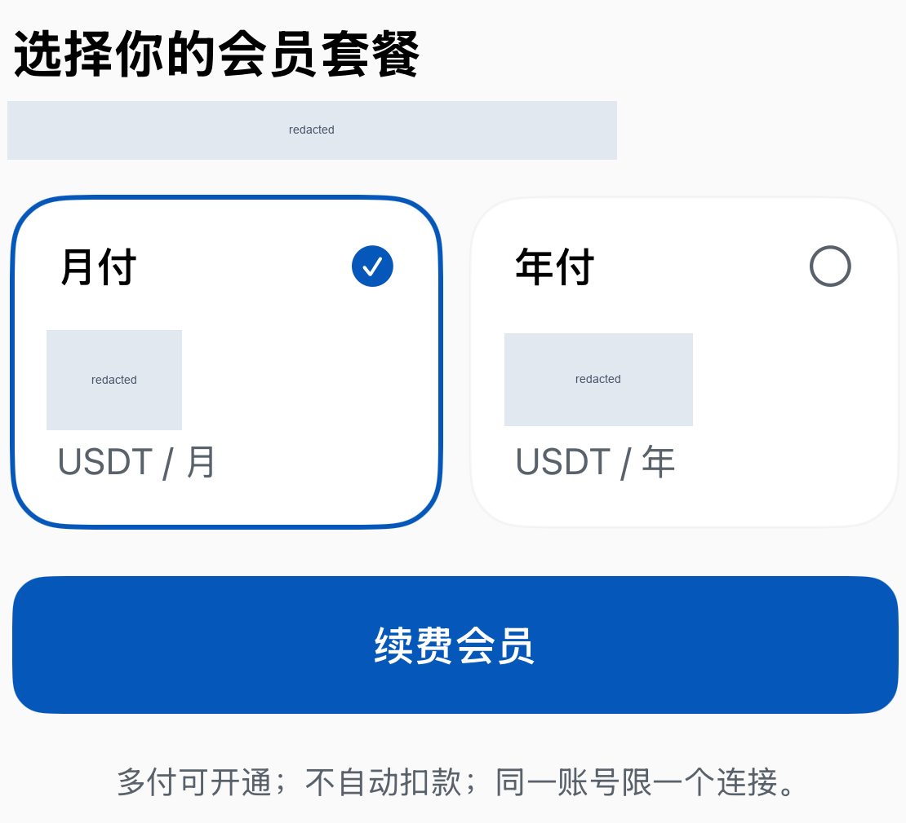

[Open full size](vpn-subscription/membership-renewal.png)

### Payment return with an unfinished order

iOS Simulator · 2026-10-15 · 1088 × 585

An unfinished-order state from historical review. Amounts and time values are removed. No real settlement is demonstrated.

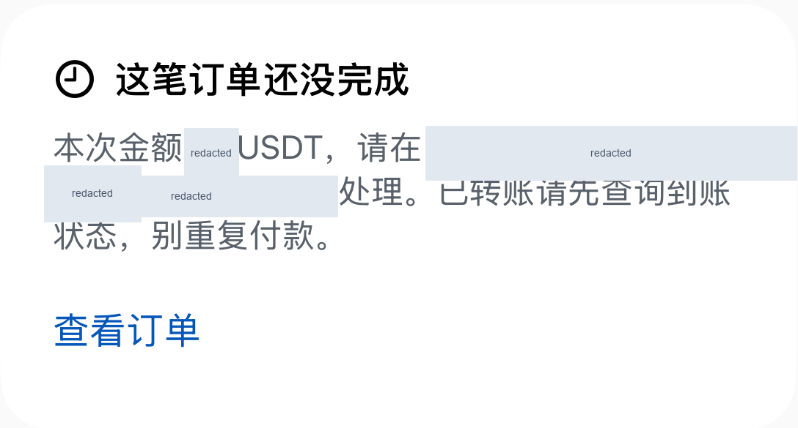

[Open full size](vpn-subscription/payment-return-pending.png)

## CareLens

An image-input care prototype with no-key mocks and seeded demonstration data.

**My work:** Prototype flows, image-input API boundaries and explicit provider-versus-mock documentation.

**Decision:** Parse a model response against a schema, and keep a mock result distinct from recognition accuracy.

**AI scope:** Claude image-input integration in source; deterministic mocks without a key.

Provider behavior, OCR accuracy, clinical correctness and deployment availability are unverified.

[Case / source](https://github.com/asdc163/carelens)

### Care prototype landing page

Repository screenshot · date unknown · 2880 × 1800

Existing public prototype image with fictional sample content. Capture date is unknown; OCR and clinical performance were not validated. UI pixels are unchanged.

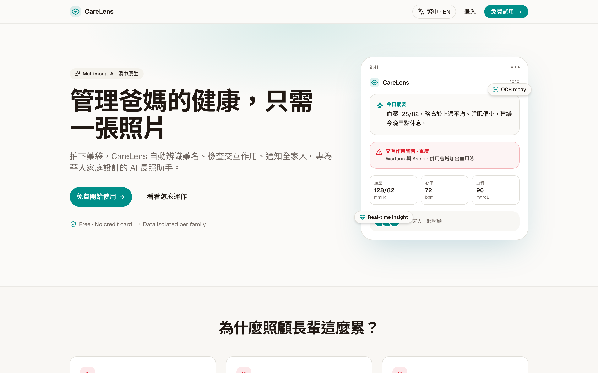

[Open full size](carelens/prototype-landing.png)

### Prototype household overview

Repository screenshot · date unknown · 2360 × 2220

Existing prototype screenshot, cropped to the main panel. Sample names, email and numeric fields are removed. It is not clinical or model-performance evidence.

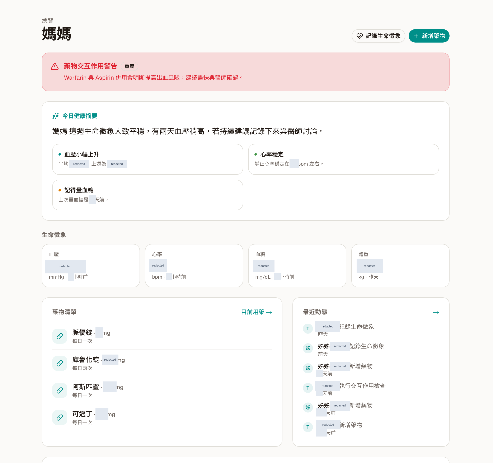

[Open full size](carelens/prototype-dashboard.png)

## ethers-v6-codemod

An AST-based JavaScript migration tool.

**My work:** Public migration-tool implementation and documentation.

**Decision:** Match syntax before changing a source expression.

**AI scope:** Engineering tooling; no model-backed runtime is claimed.

No fabricated app screen. Tool execution was not rerun for this portfolio update.

[Case / source](https://github.com/asdc163/ethers-v6-codemod)

This is a command-line tool without a product UI; no app screenshot was fabricated.

