# 產品畫面與案例

[English](README.md) · [作品集](../README.zh-TW.md) · [網站資料檔](../portfolio.json)

這裡保留實際產品或原型的畫面。商用畫面經裁切及不透明遮罩處理；沒有重畫介面。圖說會交代日期、平台與驗證範圍。

歷史截圖與本機示範不代表目前正式環境、真實付款或模型效能。專案起訖時間未提供，沒有從截圖日期推算。

[後續網站使用方式](WEBSITE-HANDOFF.md)

## 節點服務手機介面

讓接手團隊能嵌入的原生元件；驗收宿主與正式整合入口分開。

**我的工作：** 產品流程、AI 協作實作、整合邊界與分平台驗收整理。

**關鍵取捨：** 確認時重新檢查報價快照；正式服務與導覽由宿主負責。

**AI 範圍：** AI 協作開發；展示的產品行為依確定規則執行。

不宣稱已完成實體裝置、真實錢包、正式服務或商店上架驗證。

[完整案例／來源](https://github.com/asdc163/ai-builder-portfolio/tree/main/cases/node-interface)

### 節點搜尋與網路卡片

iOS Simulator · 2026-10-31 · 686 × 779

歷史 iOS 元件畫面；已移除節點識別碼與數值。

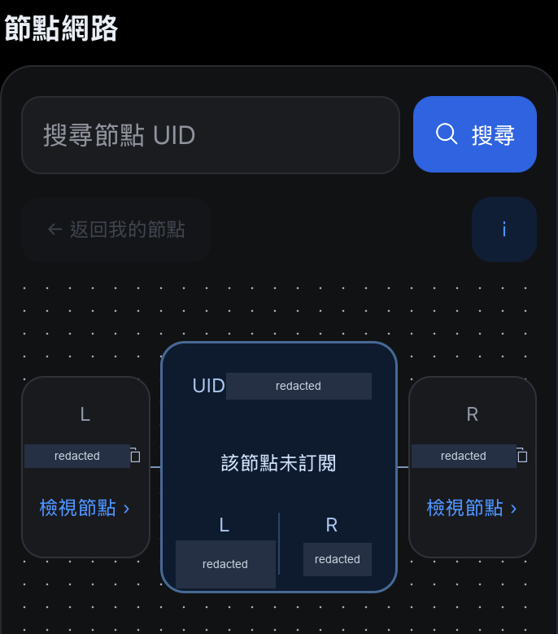

[開啟原尺寸](node-interface/ios-network.png)

### Android 節點網路版面

Android Emulator · 2026-10-30 · 1029 × 1240

同一元件的獨立 Android 截圖；已移除識別碼與數值。

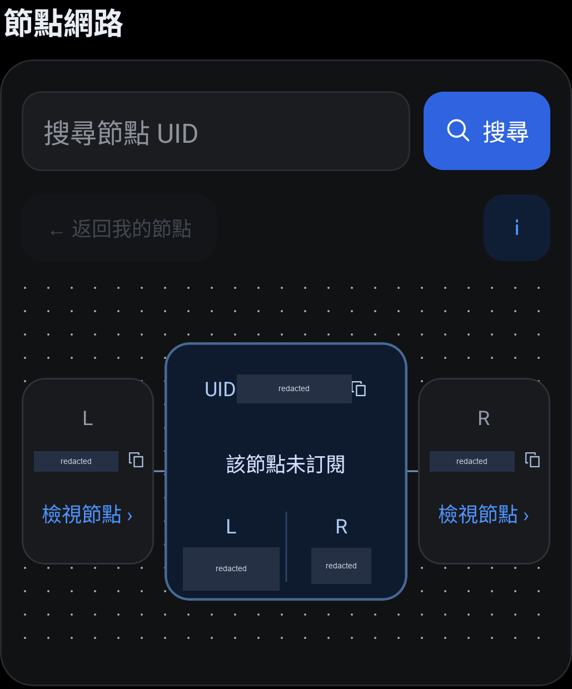

[開啟原尺寸](node-interface/android-network.png)

## 社群任務平台

參與者送件與營運審核，包含重試與補件。

**我的工作：** 參與者與營運流程、實作、恢復規則與交接審查。

**關鍵取捨：** 重試不能重複發點；附件必須有明確的存取邊界。

**AI 範圍：** AI 協作交付；本機任務及審核紀錄不代表真實模型或外部服務已驗證。

不宣稱公開託管、接收方部署、真實錢包或外部服務已完成驗證。

[完整案例／來源](https://github.com/asdc163/ai-builder-portfolio/tree/main/cases/quest-platform)

### 送件後等待審核

Chrome mobile viewport · 2026-10-30 · 358 × 246

本機前端審查的實際任務彈窗；裁去品牌、帳戶情境與背景資料。

[開啟原尺寸](quest-platform/submission-waiting.png)

### 退件原因與補件入口

Chrome mobile viewport · 2026-10-30 · 358 × 408

同一任務收到補件要求的狀態；已裁去背景並遮蔽審核時間。

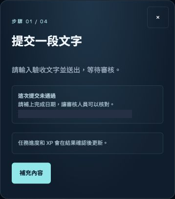

[開啟原尺寸](quest-platform/submission-needs-changes.png)

## 現貨交易介面

可獨立審查的原生前端示範，訂單狀態在本機運作。

**我的工作：** 畫面行為、狀態一致性、原生交接與分平台審查。

**關鍵取捨：** Session 轉換使用 reducer 當下狀態；原生介面與示範控制器分開。

**AI 範圍：** AI 協作開發；報價、訂單及簽名均為本機模擬。

沒有真實資產或交易；分平台檢查對應具名版本與選定測試，不當成最終版本單次全套通過。

[完整案例／來源](https://github.com/asdc163/ai-builder-portfolio/tree/main/cases/spot-interface)

### 示範下單介面

iOS Simulator · 2026-10-30 · 650 × 1440

原生純前端示範；裁去品牌標頭，移除報價、餘額及客製資產名稱。

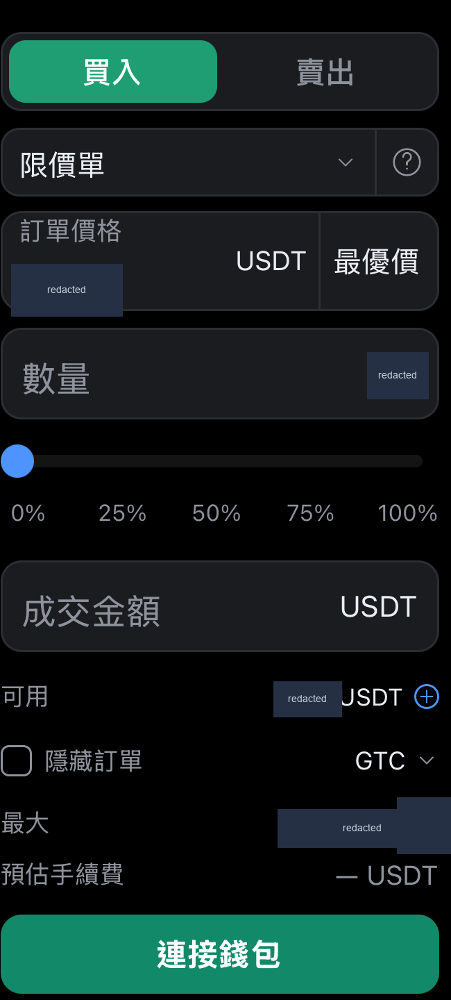

[開啟原尺寸](spot-interface/ios-order-entry.png)

### 本機委託建立結果

iOS Simulator · 2026-10-30 · 1178 × 815

本機模擬委託，不是真實交易；已移除訂單數值、時間、餘額及客製資產名稱。

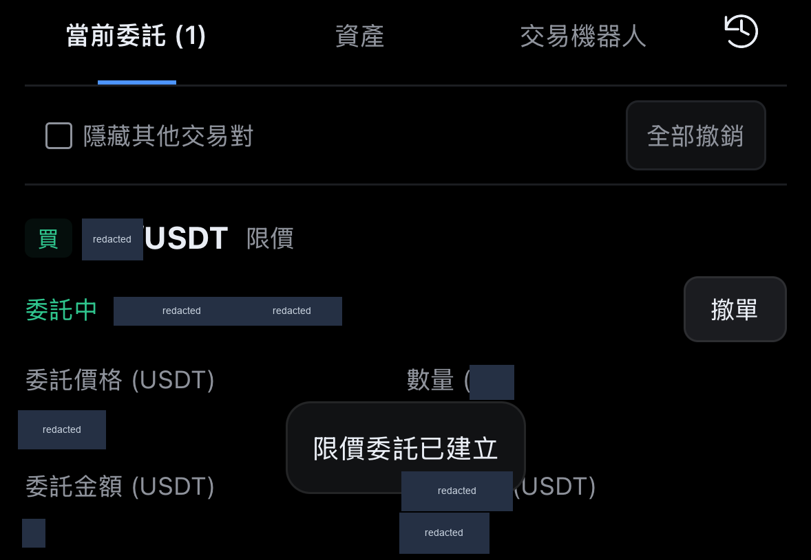

[開啟原尺寸](spot-interface/ios-order-result.png)

### 窄屏與放大字級

Android Emulator · 2026-10-30 · 1080 × 2185

歷史最終版的針對性響應檢查畫面；已移除財務數值，滑桿百分比為固定操作標籤。

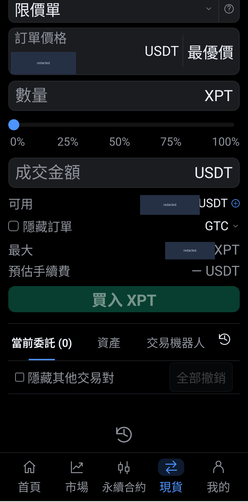

[開啟原尺寸](spot-interface/android-large-text.png)

## 托福單字隨身學

以離線單字學習為核心，Gemini 擴充為選配。

**我的工作：** 學習流程、詞庫整理、模型選配路徑與 AI 協作實作。

**關鍵取捨：** 核心字典與複習工作不依賴模型金鑰。

**AI 範圍：** 公開來源有 Gemini 整合；本次截圖只操作無金鑰流程。

本次補拍不證明模型品質、學習成效或部署可用性。

[完整案例／來源](https://github.com/asdc163/toefl-vocab)

### 字義、字根與詞性家族

Chrome desktop · 2026-11-01 · 450 × 610

由公開來源在本機補拍的無金鑰字典流程；裁取彈窗上半部，未執行 Gemini。

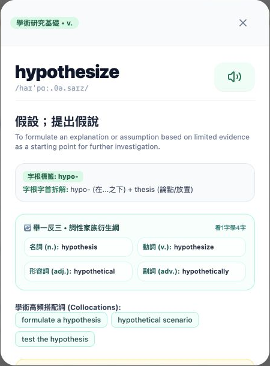

[開啟原尺寸](toefl-vocab/word-detail.png)

### 單字練習題

Chrome desktop · 2026-11-01 · 514 × 566

本機補拍，使用預設示範進度；不含學習者紀錄或模型回覆。

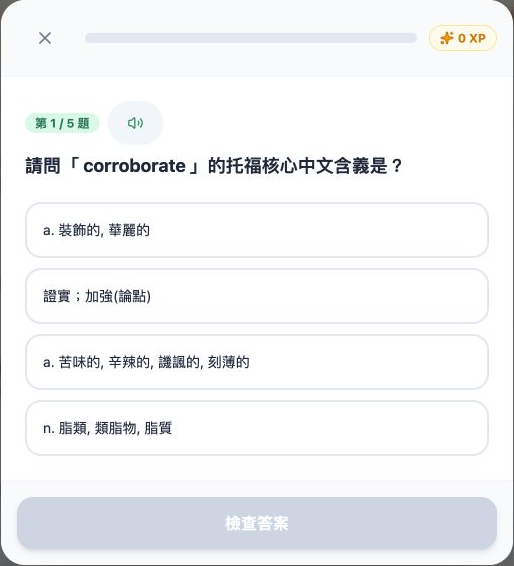

[開啟原尺寸](toefl-vocab/quiz-question.png)

## PM Signal Lab

以本機工作表及自編練習，整理能被追問的產品決策。

**我的工作：** 從來源到決策的流程、證據界線，以及自編 AI 上線審查練習。

**關鍵取捨：** 回覆流暢還不夠，缺乏依據的決策需要明確審查。

**AI 範圍：** AI 產品評估素材；公開練習為虛構案例，不是真實模型效能測試。

截圖不代表新一輪正式部署、真人研究或成長成效。

[完整案例／來源](https://github.com/asdc163/pm-signal-lab)

### 桌面首次開啟工作表

Chrome desktop · 2026-08-16 · 1440 × 1000

歷史本機畫面，訪談明確標示為虛構示範；UI 像素未修改。

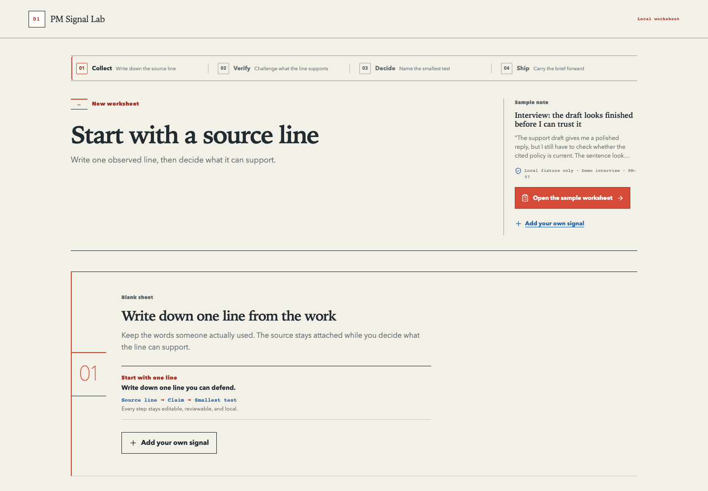

[開啟原尺寸](pm-signal-lab/first-run-desktop.png)

### 窄屏首次開啟工作表

Chrome mobile viewport · 2026-08-16 · 390 × 844

同一首次開啟狀態的歷史響應畫面；UI 像素未修改。

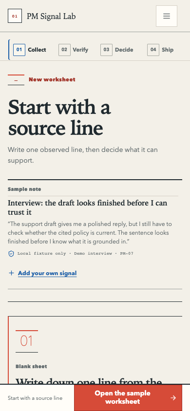

[開啟原尺寸](pm-signal-lab/first-run-mobile.png)

## OpenClaw Dashboard

在本機檢視代理工作區，同時保留唯讀邊界的看板。

**我的工作：** 唯讀營運介面、解析邊界與公開交接文件。

**關鍵取捨：** 檢視工作區不應同時取得執行代理操作的路徑。

**AI 範圍：** 代理營運工具；截圖使用虛構空白工作區，不是真實代理執行。

不宣稱具備託管控制平台、登入保護或真實代理效能。

[完整案例／來源](https://github.com/altoslab447/openclaw-dashboard)

### 唯讀看板與空白示範工作區

Chrome desktop · 2026-11-01 · 1470 × 717

在隔離、明示虛構的工作區補拍；沒有真實代理、私人設定或營運日誌，UI 像素未修改。

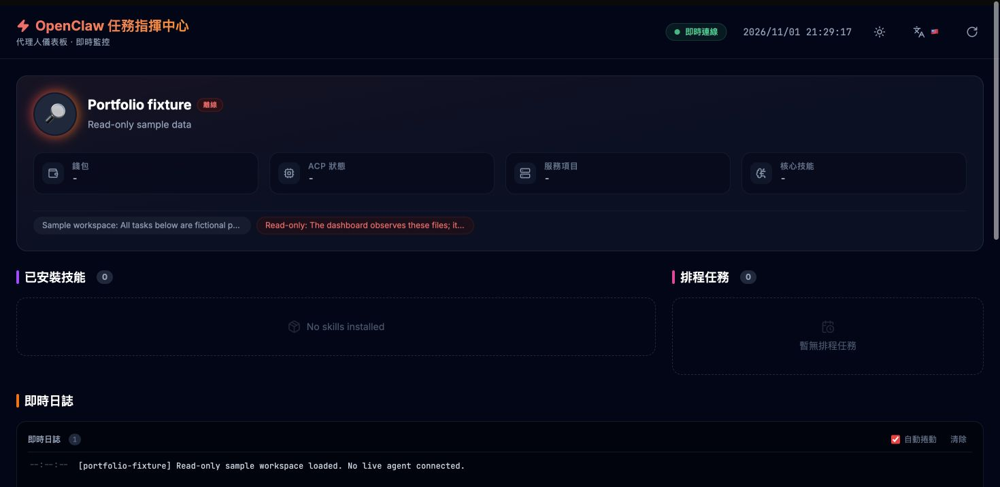

[開啟原尺寸](openclaw-dashboard/synthetic-workspace.png)

## Telegram 社群營運機器人

社群參與、群主私訊管理，以及投遞結果不明時的恢復。

**我的工作：** 參與規則、角色檢查、投遞行為與商用交接審查。

**關鍵取捨：** 敏感操作重新核對群主身分，並保留投遞結果不明的狀態。

**AI 範圍：** AI 協作開發；機器人規則與投遞決策依確定程式規則執行。

歷史圖早於群主專用私訊管理改版，不能當成現行操作證據。

[完整案例／來源](https://github.com/asdc163/telegram-community-bot-case-study)

### 早期營運功能選單

Telegram client · 2026-10-13 · 464 × 280

群主專用私訊管理改版前的歷史片段，僅說明功能範圍，不代表現行權限流程；已裁去品牌與對話情境。

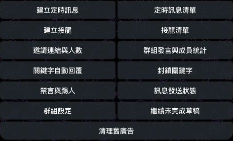

[開啟原尺寸](telegram-community-bot/historical-command-inventory.png)

## VPN 訂閱系統

訂閱結帳、付款對帳與客戶端權限狀態。

**我的工作：** 續費流程、付款狀態邊界、客戶端恢復與工程交接審查。

**關鍵取捨：** 從付款頁返回不等於結算完成；未完成訂單需要清楚的恢復入口。

**AI 範圍：** AI 協作開發；付款與權限判斷依確定規則執行。

不宣稱真實資金、實體裝置、目標網路或消費者正式發布已驗證。

[完整案例／來源](https://github.com/asdc163/vpn-subscription-case-study)

### 續費方案選擇

iOS Simulator · 2026-10-15 · 1110 × 1010

歷史工程審查畫面；已移除售價與付款路徑，畫面不代表實際網路可用性。

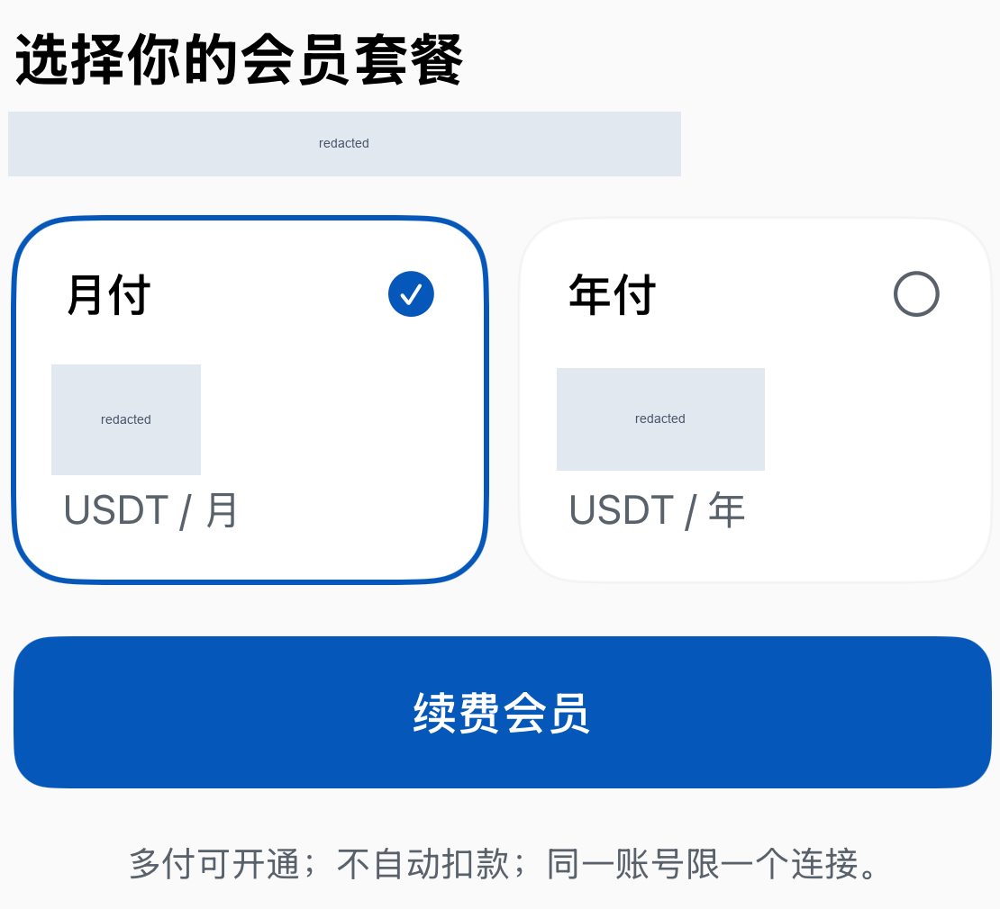

[開啟原尺寸](vpn-subscription/membership-renewal.png)

### 付款返回後的未完成訂單

iOS Simulator · 2026-10-15 · 1088 × 585

歷史審查中的未完成訂單狀態；已移除金額與時間，不代表真實資金結算。

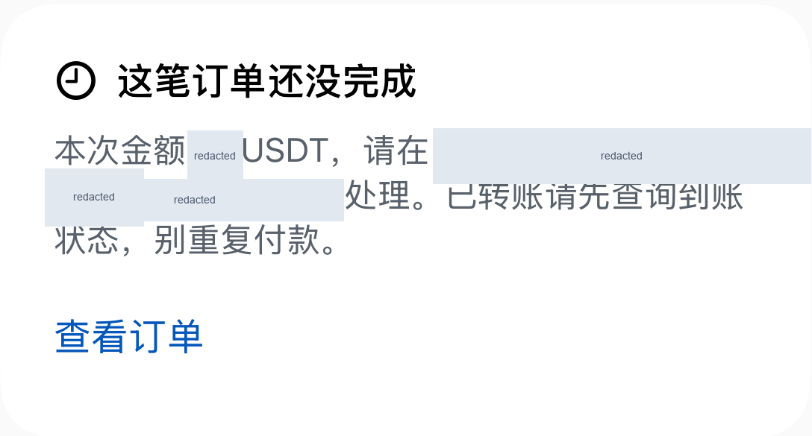

[開啟原尺寸](vpn-subscription/payment-return-pending.png)

## CareLens 照護原型

圖片輸入的照護原型，具備無金鑰 mock 與預設示範資料。

**我的工作：** 原型流程、圖片 API 邊界，以及模型與 mock 的明確區分。

**關鍵取捨：** 以 schema 解析模型回覆，並把 mock 結果與辨識準確度分開。

**AI 範圍：** 來源含 Claude 圖片輸入整合；無金鑰時使用固定 mock。

模型行為、OCR 準確度、醫療正確性與部署可用性均未驗證。

[完整案例／來源](https://github.com/asdc163/carelens)

### 照護原型首頁

Repository screenshot · 日期不詳 · 2880 × 1800

既有公開原型圖，內容為虛構示範；拍攝日期不詳，未驗證 OCR 或醫療效能，UI 像素未修改。

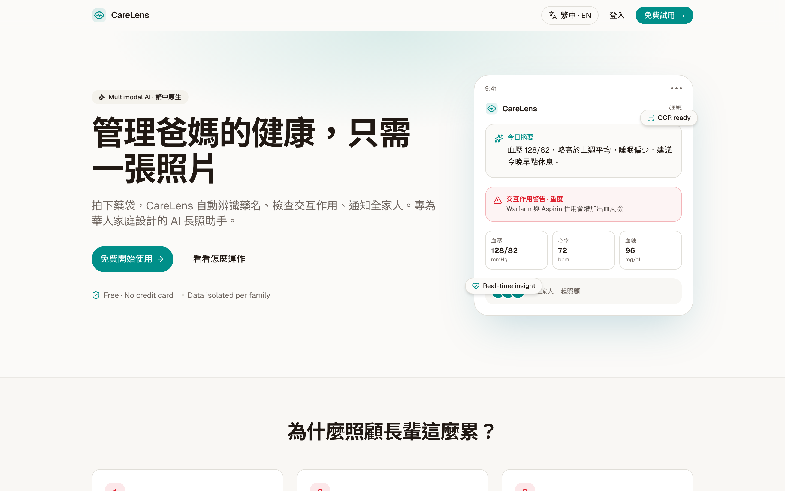

[開啟原尺寸](carelens/prototype-landing.png)

### 原型家庭照護總覽

Repository screenshot · 日期不詳 · 2360 × 2220

既有原型截圖，裁取主要內容區；已移除示範姓名、email 與數值，不作為醫療或模型效能證據。

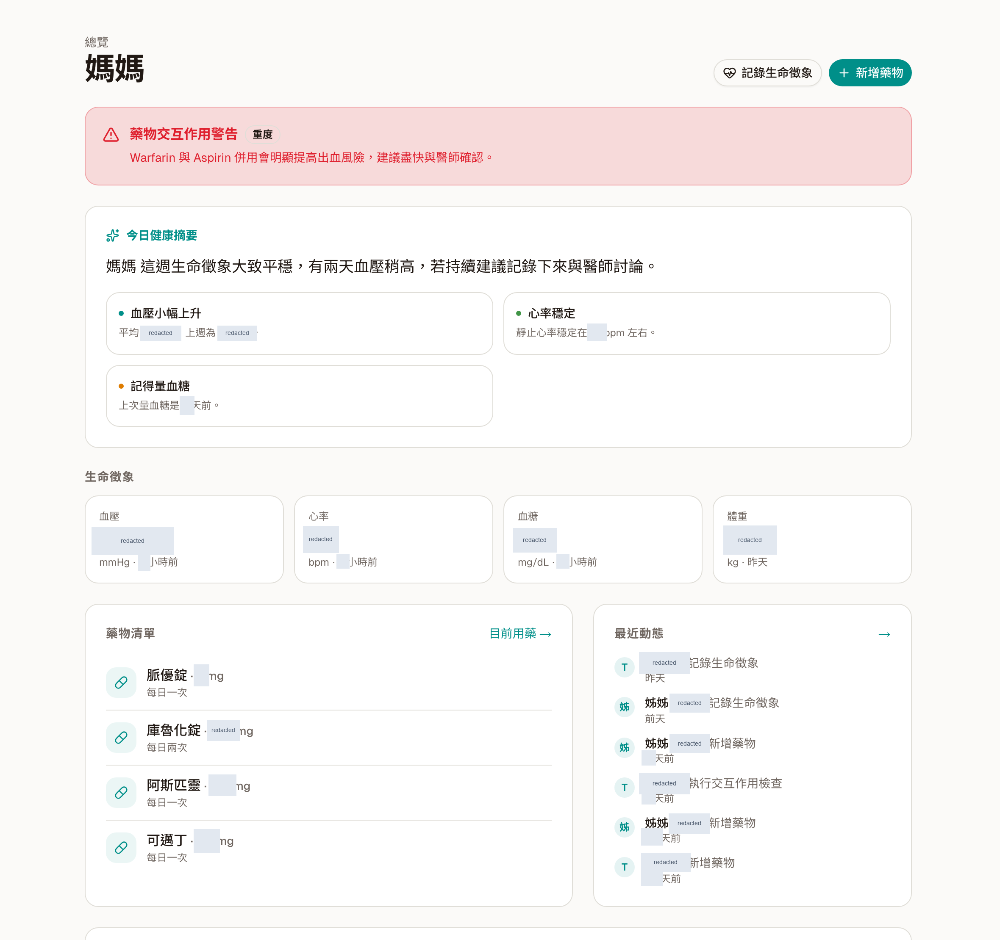

[開啟原尺寸](carelens/prototype-dashboard.png)

## ethers-v6-codemod

以 AST 進行 JavaScript 程式遷移的工具。

**我的工作：** 公開遷移工具實作與文件。

**關鍵取捨：** 先比對語法，再變更程式表達式。

**AI 範圍：** 工程工具；不宣稱執行時具有模型功能。

不為它捏造 App 畫面；本輪作品集更新未重跑工具。

[完整案例／來源](https://github.com/asdc163/ethers-v6-codemod)

這是命令列工具，沒有產品 UI，因此不製作假截圖。

